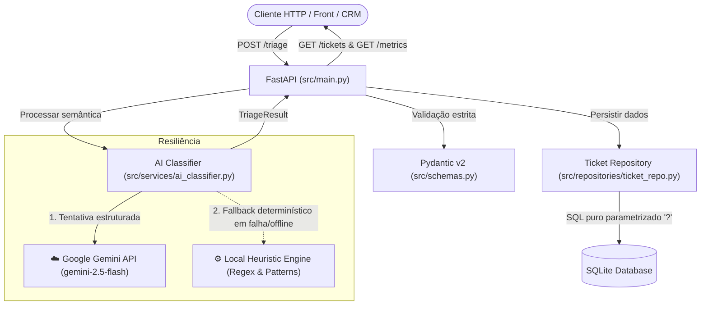

# 📬 Inbox AI API — Triagem Inteligente e Resiliente de Atendimento


-0A9EDC?logo=pytest&logoColor=white)


---

## 🎯 Resumo Executivo & Dor Real de Negócio

Em operações de suporte e atendimento ao cliente (CX), centenas de mensagens não estruturadas chegam diariamente via chat, formulários e e-mail. Na maioria das empresas, essa fila é consumida por ordem de chegada (**FIFO**), gerando um problema grave:

- **Cancelamentos e clientes insatisfeitos com risco iminente de churn** esperam horas na mesma fila que dúvidas simples de FAQ;
- **Falhas financeiras graves (ex: cobrança duplicada)** demoram para ser direcionadas ao time responsável;
- **Falta de visibilidade métrica** para os líderes da operação acompanharem a severidade e distribuição das demandas em tempo real.

O **`inbox-ai-api`** é um microsserviço REST assíncrono de alto desempenho que atua como **middleware de triagem inteligente**:
1. Recebe a mensagem bruta do cliente;
2. Analisa e categoriza semanticamente a mensagem via **Google Gemini** em uma taxonomia estrita (`financeiro`, `suporte_tecnico`, `cancelamento`, `duvida_geral`);
3. Determina o nível de urgência (`alta`, `media`, `baixa`) e orienta uma ação recomendada prática para o atendente humano;
4. **Resiliência com Fallback Determinístico Local (Graceful Degradation):** caso a API de IA sofra com limites de cota (429), lentidão ou esteja sem chave configurada, um motor heurístico local assume instantaneamente a classificação sem derrubar o serviço com erro 500;
5. Persiste as demandas em banco de dados seguro contra SQL Injection e expõe métricas operacionais em tempo real.

---

## 🏛️ Arquitetura do Sistema

A solução adota uma arquitetura em camadas simples, modular e orientada à separação de responsabilidades (SoC):



---

## 🔌 Tabela de Endpoints da API

| Método | Endpoint | Descrição | Status Sucesso |
|:---|:---|:---|:---|
| `GET` | `/` | Health check da aplicação | `200 OK` |
| `POST` | `/triage` | Triagem e persistência de mensagens de atendimento | `201 Created` |
| `GET` | `/tickets` | Listagem de tickets com filtro opcional por `urgency` | `200 OK` |
| `GET` | `/metrics` | Métricas consolidadas em tempo real | `200 OK` |

### Exemplos Práticos de Requisição e Resposta

#### 1. Triar Mensagem Crítica de Cancelamento (`POST /triage`)
**Requisição via curl:**
```bash
curl -X POST "http://localhost:8000/triage" \
  -H "Content-Type: application/json" \
  -d '{"content": "Quero cancelar meu contrato agora mesmo, o serviço não atende minhas necessidades!"}'
```

**Resposta JSON (`201 Created`):**
```json
{
  "id": 1,
  "content": "Quero cancelar meu contrato agora mesmo, o serviço não atende minhas necessidades!",
  "category": "cancelamento",
  "urgency": "alta",
  "suggested_action": "Acionar time de retenção imediatamente para contato telefônico com o cliente.",
  "used_fallback": false,
  "created_at": "2026-11-27 14:05:17"
}
```

#### 2. Listar Tickets com Filtro de Urgência Alta (`GET /tickets?urgency=alta`)
**Requisição via curl:**
```bash
curl -X GET "http://localhost:8000/tickets?urgency=alta"
```

**Resposta JSON (`200 OK`):**
```json
[
  {
    "id": 1,
    "content": "Quero cancelar meu contrato agora mesmo, o serviço não atende minhas necessidades!",
    "category": "cancelamento",
    "urgency": "alta",
    "suggested_action": "Acionar time de retenção imediatamente para contato telefônico com o cliente.",
    "used_fallback": false,
    "created_at": "2026-11-27 14:05:17"
  }
]
```

#### 3. Consultar Métricas Consolidadas (`GET /metrics`)
**Requisição via curl:**
```bash
curl -X GET "http://localhost:8000/metrics"
```

**Resposta JSON (`200 OK`):**
```json
{
  "total_tickets": 25,
  "by_category": {
    "cancelamento": 7,
    "financeiro": 10,
    "suporte_tecnico": 5,
    "duvida_geral": 3
  },
  "by_urgency": {
    "alta": 9,
    "media": 13,
    "baixa": 3
  },
  "fallback_count": 2
}
```

---

## ⚡ Guia Rápido de Instalação e Execução Local (Em 3 Passos)

### Pré-requisitos
- Python 3.10 ou superior instalado;
- Git instalado.

### Passo 1: Clonar o repositório e preparar o ambiente virtual
```bash
git clone https://github.com/Sunamitadeev/Inbox-ai-api.git
cd Inbox-ai-api

python3 -m venv .venv
source .venv/bin/activate
pip install -r requirements.txt
```

### Passo 2: Configurar variáveis de ambiente (Opcional)
```bash
cp .env.example .env
```
> **Nota:** Se você **não** configurar uma `GEMINI_API_KEY`, a API continuará funcionando normalmente com **100% de disponibilidade**, utilizando o motor de **fallback determinístico local**.

### Passo 3: Iniciar o servidor da API
```bash
uvicorn src.main:app --reload
```
A API estará disponível em `http://localhost:8000`. Acesse a documentação interativa Swagger em **`http://localhost:8000/docs`**.

---

## 🧪 Como Executar a Suíte de Testes Automatizados

O projeto conta com suíte automatizada usando **Pytest** e **FastAPI TestClient**, com isolamento total via banco SQLite temporário descartável:

```bash
# Executar todos os testes com saída detalhada
pytest -v
```

---

## 💡 Decisões Técnicas Resumidas (ADRs)

| Decisão | Escolha | Justificativa Técnica |
|:---|:---|:---|
| **Framework Web** | FastAPI + Uvicorn | Validação nativa via Pydantic v2, suporte a lifespan assíncrono e documentação OpenAPI automática. |
| **Banco de Dados** | SQLite com SQL Puro Parametrizado (`?`) | Zero dependência externa de infraestrutura, facilidade extrema para testes unitários/CI e proteção total contra SQL Injection. |
| **Resiliência da IA** | Gemini 2.5 Flash + Fallback Heurístico Local | Alta disponibilidade (SLA): se a API externa cair ou sofrer rate limit (HTTP 429), a operação de atendimento nunca é interrompida. |
| **Validação Estrita** | Pydantic v2 com Tipos `Literal` | Protege a integridade do domínio rejeitando entradas inválidas ou vazias no gateway HTTP com `HTTP 422`. |

*Para mais detalhes sobre as decisões e requisitos, consulte:*
- 📄 [Documento de Requisitos de Negócio (BRD)](docs/BRD.md)
- 📐 [Documento de Arquitetura e ADRs](docs/ARCHITECTURE.md)

---

## 🚀 Próximos Passos de Escalabilidade

1. **Migração do Banco para PostgreSQL:** Como adotamos o *Repository Pattern*, a transição para PostgreSQL ou Amazon RDS requer alteração apenas na camada de banco (`src/database.py`), mantendo intactas as rotas e regras de negócio.
2. **Filas Assíncronas com Celery/RabbitMQ/Redis:** Para volumes superiores a 5.000 req/min, desacoplar a chamada ao LLM através de processamento assíncrono em segundo plano com webhooks de notificação.
3. **Autenticação e Autorização:** Implementação de JWT (JSON Web Tokens) e API Keys por tenant para controle de acesso corporativo.
